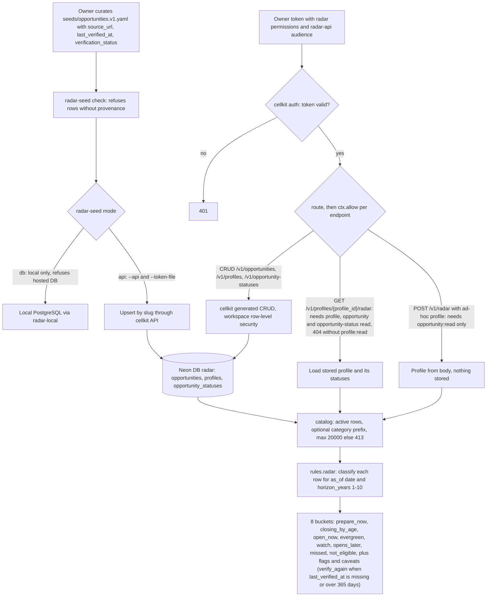
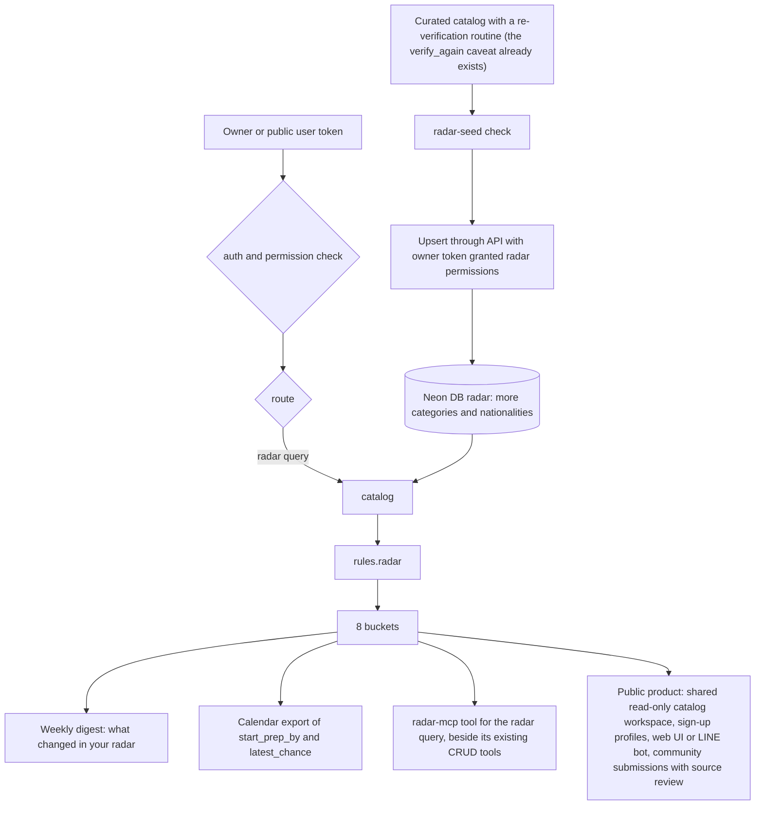

# 01 — Business process (As-Is / To-Be)

life-radar คือ cell API (FastAPI บน platform-cellkit, Railway + Neon) ที่เก็บแคตตาล็อกโอกาสในชีวิต (ทุน, working holiday, ใบอนุญาต ฯลฯ) ในรูปแบบเดียว แล้วจับคู่กับโปรไฟล์ (วันเกิด สัญชาติ การศึกษา) เพื่อบอกว่าโอกาสไหนปิดเพราะอายุ ต้องเริ่มเตรียมตัวตอนนี้ หรือเปิดอยู่ ผู้ใช้ตอนนี้คือ owner คนเดียว

Last reviewed: 2026-11-27 · commit `aa30c5b`

## As-Is (จากโค้ดวันนี้)

CI (`.github/workflows/ci.yml`) รัน pytest, mypy, ruff; Railway deploy `radar-api` จาก `main` เมื่อ CI ผ่าน (Wait for CI ตาม README) [ต้องยืนยัน] ว่า `radar-api` บน Railway รันคอมมิตล่าสุดและตั้งตัวแปร DB/JWT ครบ ดูจากโค้ดไม่ได้ ส่วน seed บน hosted ยังไม่โหลดตาม `PRODUCT.md` (สถานะ 2026-10-17) [ต้องยืนยัน] ว่าโหลดแล้วหรือยัง

Sources: `cell.yaml`, `src/life_radar/routes.py` (`register`, `catalog`, `profile_radar`, `adhoc_radar`), `src/life_radar/rules.py` (`classify`, `radar`, `BUCKETS`), `src/life_radar/seed.py` (`read`, `upsert_db`, `upsert_api`, `main`), `migrations/0001_radar.sql`, `README.md`, `PRODUCT.md`

## To-Be (PRODUCT.md §Roadmap)

Sources: `PRODUCT.md` §Roadmap (items 1-4), `PRODUCT.md` §Non-goals (v0.1)

## Gap

| ID | As-Is → To-Be | Status | Owner | Evidence |
|---|---|---|---|---|
| G1 | owner ยังไม่ได้รับสิทธิ์ `radar` และ token → grant สิทธิ์ แล้วโหลด seed ผ่าน API บน hosted | todo | owner | `PRODUCT.md` §Roadmap 1 และ Status; `README.md` §Develop and operate [ต้องยืนยัน] ว่าทำแล้วหรือไม่ |
| G2 | catalog เป็นชุด seed v1 สำหรับพลเมืองไทย และผลลัพธ์มี caveat `verify_again` อยู่แล้ว (`rules.classify`, เกิน 365 วันหรือไม่มี `last_verified_at`) → เพิ่มหมวด สัญชาติอื่น และขั้นตอนตรวจแหล่งข้อมูลซ้ำเป็นรอบ (ไม่ใช่เพิ่ม caveat) | todo | claude | `PRODUCT.md` §Roadmap 2; `seeds/opportunities.v1.yaml` |
| G3 | ไม่มี digest, calendar export หรือ MCP tool สำหรับเรียกคำนวณ radar (`radar-mcp` มี CRUD `radar.<resource>.list/get/create/update/delete` อยู่แล้ว) → weekly digest, calendar export และ tool เรียก radar โดยเฉพาะ ไม่ต้องสร้าง MCP server ใหม่ | todo | claude | `PRODUCT.md` §Roadmap 3; `AGENTS.md` (radar-mcp), `.mcp.json` |
| G4 | ใช้ได้เฉพาะ owner ผ่าน API → public product (catalog แบบ read-only, สมัครโปรไฟล์, web UI หรือ LINE bot, community submissions) | decide | owner | `PRODUCT.md` §Roadmap 4 และ §Users; ต้องการการตัดสินใจเรื่องขอบเขตและเวลา |

## Open questions

- `radar-api` บน Railway รันคอมมิตไหน และ seed ถูกโหลดบน hosted แล้วหรือยัง (เอกสารใน repo ระบุแค่ผลวันที่ 2026-10-17)
